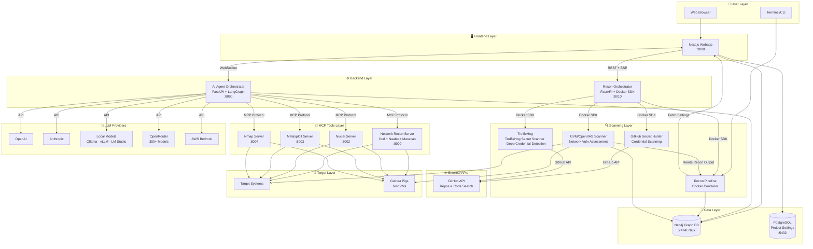
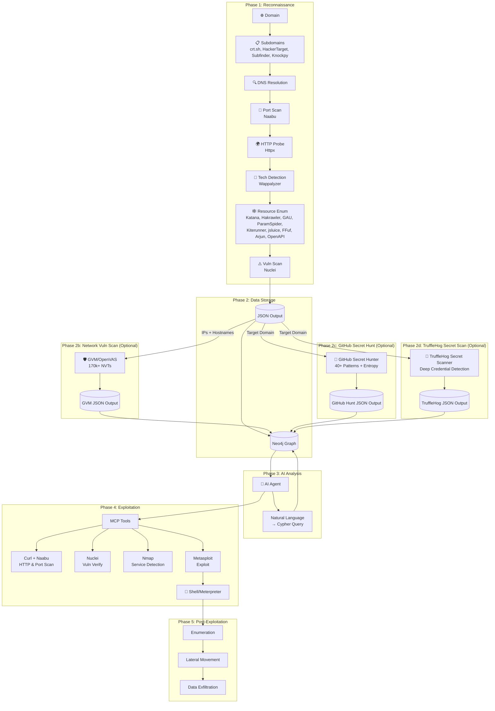
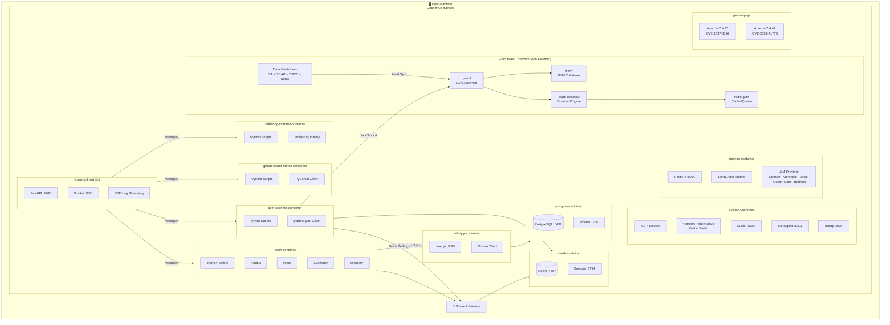
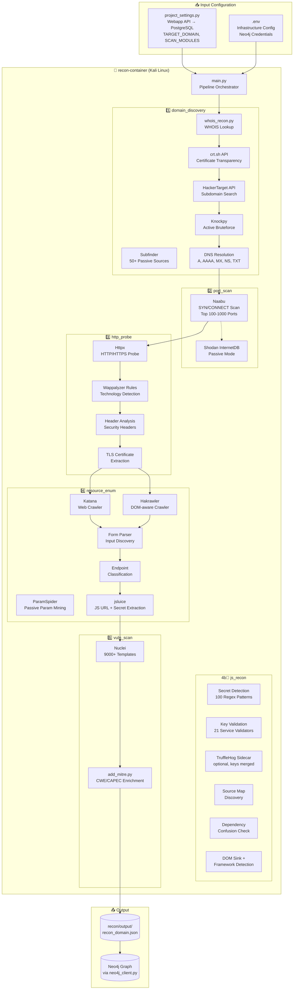
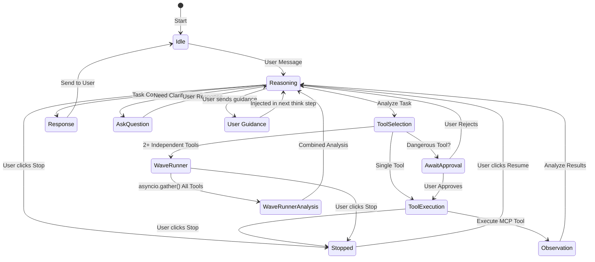
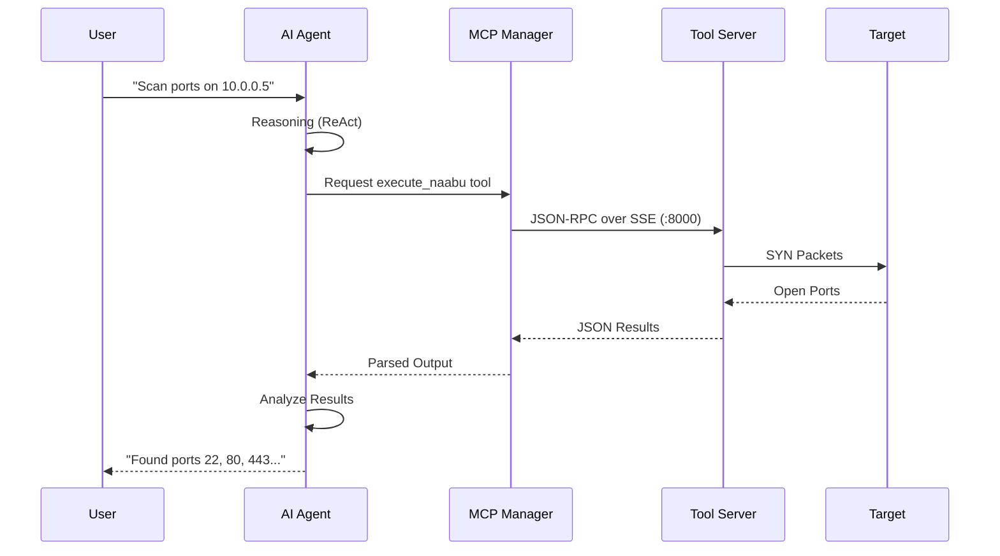
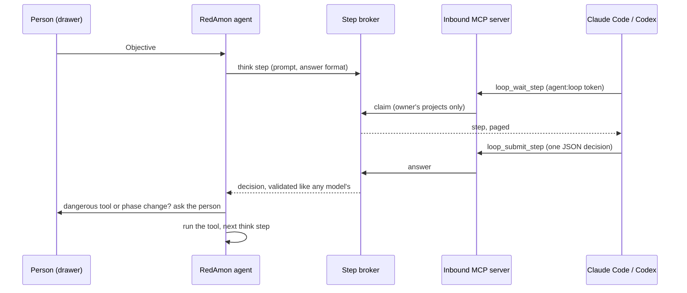
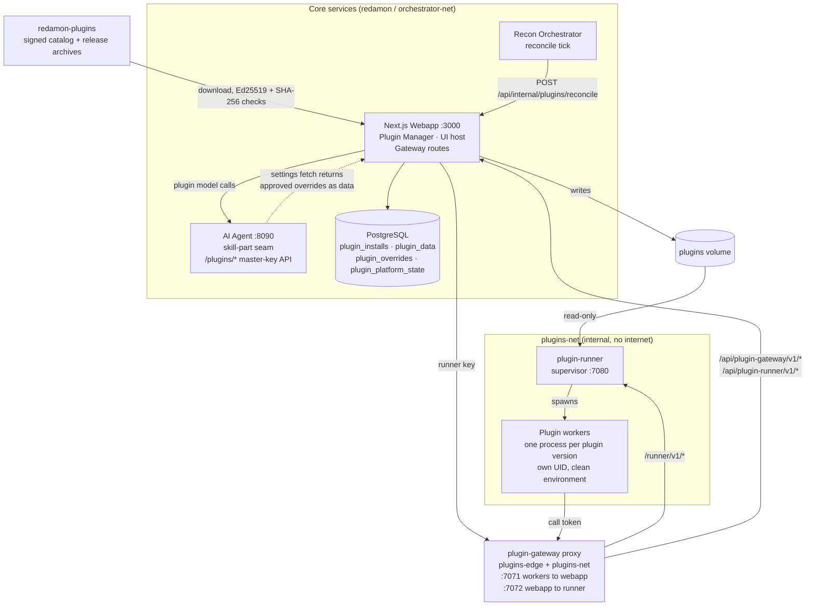

# System Architecture

## High-Level Architecture

## Data Flow Pipeline

## Docker Container Architecture

## Exposed Services & Ports

> **Host-exposure policy (since 5.3.1).** Only the webapp (`3000`), the agent
> API (`8090`) and the reverse-shell listener (`4444`) are published on all
> interfaces. Everything else in this table is bound to **`127.0.0.1` only** —
> reachable from the host for debugging, not from the LAN. The MCP servers
> (`8000-8005`) additionally require `Authorization: Bearer $MCP_AUTH_TOKEN`;
> the agent supplies it automatically over the internal Docker bridge. See
> [README.MCP.md](README.MCP.md#security-notice) and STRIDE S10/E1/I9/S13.

| Service | URL | Exposure | Description |
|---------|-----|----------|-------------|
| **Webapp** | http://localhost:3000 | LAN | Main UI — create projects, configure targets, launch scans |
| PostgreSQL | 127.0.0.1:5432 | Loopback | Primary database (Prisma) |
| Neo4j Browser | http://127.0.0.1:7474 | Loopback | Graph database UI for attack surface visualization |
| Neo4j Bolt | 127.0.0.1:7687 | Loopback | Neo4j driver protocol (used by agent) |
| Recon Orchestrator | http://127.0.0.1:8010 | Loopback | Manages recon pipeline containers. **Network-isolated:** on its own `redamon-orchestrator-net` (not `redamon`) — reachable from the host and the webapp, but not from the worker. |
| Agent API | http://localhost:8090 | LAN | AI agent WebSocket + REST API |
| MCP Network Recon | http://127.0.0.1:8000/sse | Loopback + token | curl + naabu (HTTP probing, port scanning) |
| MCP Nuclei | http://127.0.0.1:8002/sse | Loopback + token | Nuclei vulnerability scanner |
| MCP Metasploit | http://127.0.0.1:8003/sse | Loopback + token | Metasploit Framework RPC |
| MCP Nmap | http://127.0.0.1:8004/sse | Loopback + token | Nmap network scanner |
| Metasploit Progress | http://127.0.0.1:8013 | Loopback | Live progress streaming for long-running exploits |
| Tunnel Manager | http://127.0.0.1:8015 | Loopback | ngrok/chisel tunnel configuration API |
| RedAmon Terminal | ws://127.0.0.1:8016 | Loopback | Kali sandbox PTY shell access (xterm.js; browser reaches it via the agent proxy) |
| Metasploit Listener | 0.0.0.0:4444 | LAN (by design) | Reverse shell listener — a target connects back here in direct/no-tunnel mode |

The plugin services (`plugin-runner`, `plugin-gateway`) publish no host port; see
[Plugin Platform](#plugin-platform).

## Recon Pipeline Detail

## Agent Workflow (ReAct Pattern)

## MCP Tool Integration

## Agent in the Loop (an External Brain)

With `AGENT_IN_THE_LOOP_ENABLED=true` a person may pick `loop/mcp` as a chat's model. The
loop above is unchanged; only its "Reasoning" calls go somewhere else: each becomes a step
the person's own MCP client (Claude Code, Codex) claims and answers over the inbound MCP
server, while tools, approvals and the graph stay in RedAmon.

Rules and setup: [README.MCP.SERVER.md §9](README.MCP.SERVER.md#9-agent-in-the-loop) and the
`agent-in-the-loop` skill.

## Plugin Platform

Plugins are optional features installed on demand from the signed
[`redamon-plugins`](https://github.com/samugit83/redamon-plugins) catalog. The platform that
hosts them is part of every RedAmon stack, and runs plugin code, which is third-party code,
isolated. The two plugin services are in the `plugins` compose profile, and the webapp's plugin
wiring lives in the overlay `docker-compose.plugins.yml`; `redamon.sh` loads the overlay and
starts the profile on every `install`, `update` and `up`, which a plain `docker compose up -d`
does not. The plugin networks need Docker Engine 28.0.0 or newer, so RedAmon does too, and a
host that fails the plugin preflight is refused with the reason before any core service is
created. The design is in
[README.PLUGINS.md](README.PLUGINS.md); the plugin author's contract is in
[README.PLUGIN_SDK.md](README.PLUGIN_SDK.md).

**Containers, networks and the volume.**

| Piece | What it is |
|---|---|
| `plugin-runner` | A supervisor (FastAPI on `:7080`) that starts one worker process per (plugin, version), each under its own UID with memory and process limits and a clean environment. Only on `plugins-net`; it reads the `plugins` volume read-only and holds no database credentials, LLM keys or token secret. |
| `plugin-gateway` | A small standard-library proxy built from the same image. It is the only door between `plugins-net` and the rest of the stack: `:7071` passes only the webapp's `/api/plugin-gateway/v1/*` (plugin code) and `/api/plugin-runner/v1/*` (the supervisor's run list), and `:7072` passes only the webapp's calls to the supervisor's `/runner/v1/*`. It joins `plugins-edge` and `plugins-net`, never `redamon`. |
| `plugins-net`, `plugins-edge` | Two `internal` bridge networks (no route out) with `gateway_mode_ipv4: isolated`, which removes the bridge's own address on the host. The overlay adds the webapp to `plugins-edge`. |
| `plugins` volume | The installed plugin versions. Only the webapp's Plugin Manager writes it (mounted at `/data/plugins` through the overlay); only `./redamon.sh purge` removes it. |
| Postgres tables | `plugin_installs`, `plugin_data`, `plugin_overrides`, `plugin_platform_state`. |

Nothing in the platform publishes a host port.

**Two paths, designed differently on purpose.**

- **Action path** (user-triggered, may be slow): a click in the UI reaches the webapp, which
  checks the user's access, mints a short-lived call token and asks the runner (through the
  proxy) to run the action. The worker calls back through the proxy to the Gateway routes in the
  webapp, which check the token and the permissions an admin granted before reading a session,
  storing plugin data, proposing a skill-text change, or asking the agent to make a model call
  with the user's chosen model. The provider key never leaves the agent.
- **Behaviour path** (core-triggered, never blocks): the agent never calls plugin code. A
  skill-text change a person has approved is a row in Postgres. The webapp adds the approved
  versions to the project settings it returns to the agent's master-key settings fetch, and the
  agent's seam renders a part's approved text only while the factory text it was approved against
  is unchanged (the SHA-256 recorded at approval) and the text passes validation; otherwise it
  renders the factory text. If the runner is down, approved changes keep
  applying and actions answer `503`.
