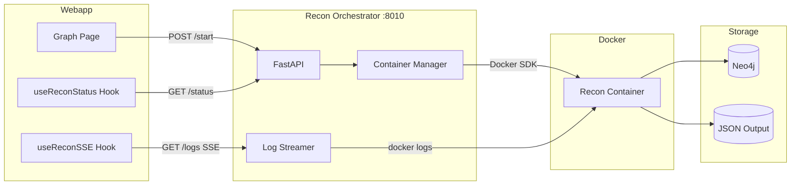

# Recon Orchestrator

FastAPI service for managing recon container lifecycle with real-time log streaming via Server-Sent Events (SSE).

## Overview

The Recon Orchestrator acts as a bridge between the webapp and the recon Docker containers. It provides:

- **Container Lifecycle Management** - Start, stop, and monitor recon containers
- **Real-time Log Streaming** - SSE-based log streaming to the frontend
- **Phase Detection** - The pipeline's own group headers set each scan's phase (see Phase Detection)
- **Status Tracking** - Track running/completed/error states per project

## Architecture



## Quick Start

```bash
# 1. Ensure Docker network exists
docker network create redamon-network

# 2. Build and start
cd recon_orchestrator
docker-compose build
docker-compose up -d

# 3. Verify health
curl http://localhost:8010/health
```

## API Endpoints

### Health Check

```
GET /health
```

Returns service health, the running scans per kind, and which optional scanner
images are installed.

```json
{
  "status": "healthy",
  "version": "1.0.0",
  "running_recons": 0,
  "running_gvm_scans": 0,
  "running_github_hunts": 0,
  "running_trufflehog_scans": 0,
  "running_ai_attack_scans": 0,
  "gvm_available": false,
  "trufflehog_available": true
}
```

`trufflehog_available` says whether `redamon-trufflehog:latest` exists. The webapp's
`/api/js-recon/trufflehog/available` reads it to warn, in the JS Recon form, that the
TruffleHog engine cannot run. The orchestrator also removes the stage directories
(`/tmp/redamon/js_recon_th_*`) a killed JS Recon run left behind: when it reaps the run's
containers or sees the run complete, and at startup for every run with no live recon
container.

### Start Recon

```
POST /recon/{projectId}/start
Content-Type: application/json

{
  "user_id": "user-123",
  "webapp_api_url": "http://localhost:3000"
}
```

Starts a new recon container for the specified project. The container will:
1. Fetch project settings from `{webapp_api_url}/api/projects/{projectId}`
2. Run the recon pipeline
3. Update Neo4j with results

**Response:**
```json
{
  "project_id": "project-123",
  "status": "starting",
  "container_id": "abc123...",
  "started_at": "2024-01-15T10:30:00Z",
  "current_phase": null,
  "phase_number": null,
  "total_phases": 7
}
```

### Get Status

```
GET /recon/{projectId}/status
```

Returns current recon status for a project.

**Status Values:**
- `idle` - No recon running
- `starting` - Container starting
- `running` - Recon in progress
- `completed` - Recon finished successfully
- `error` - Recon failed
- `stopping` - A stop is draining the run (see Stop Recon); still a live run

### Stream Logs (SSE)

```
GET /recon/{projectId}/logs
Accept: text/event-stream
```

Server-Sent Events stream of log lines. Events have the following format:

```
event: log
data: {"log": "Starting port scan...", "timestamp": "2024-01-15T10:30:00Z", "phase": "Port Scanning", "phaseNumber": 2, "isPhaseStart": false, "level": "info"}

event: complete
data: {"status": "completed", "completedAt": "2024-01-15T10:45:00Z", "error": null}
```

**Event Types:**
- `log` - Log line with phase detection
- `error` - Error message
- `complete` - Recon completion with final status

**Log Levels:**
- `info` - Normal log line
- `warning` - Warning message
- `error` - Error message
- `success` - Success message (phase completion, etc.)

### Stop Recon

```
POST /recon/{projectId}/stop[?graceful=false]
POST /recon/{projectId}/partial/{runId}/stop[?graceful=false]
```

The stop is **asynchronous**: it answers `stopping` at once and a background
task (`_end_run_container` in `container_manager.py`) ends the run:

1. SIGTERM to the recon (or partial-recon) container. Its handler
   (`recon/helpers/shutdown.py`) sends SIGTERM to its own processes, refuses to
   start new ones, drops new graph writes, lands the writes already queued,
   runs the node-filter sweep (the mute rules) and exits 143. The prune never
   runs on a stopped run.
2. The run's tool containers are removed at once, and again every 2 s while
   the recon container drains: they are siblings created through the broker,
   selected by the `redamon.broker-owned=1` + `redamon.run_id=<run>` labels,
   never by image name, so another project's scan is never touched.
3. When the container exits, or after `RECON_STOP_GRACE_S` (default 45 s, set
   in the orchestrator's `environment:` block), SIGKILL. The exit code is
   logged (`[stop] ... exited with code 143`), then the container is removed.

While a run is `stopping` it is live everywhere: its exit code is not read as
`error`, it keeps its memory reservation, and a new full or partial start is
refused. It then reads `idle`, which the webapp records as a canceled ScanJob.
`?graceful=false` (the project delete) kills at once and answers only when the
container is gone, so a draining run never writes into a deleted project; it
also cuts short a graceful stop already draining. The orchestrator's own
shutdown stops each run with a 5 s grace.

In-process Python traffic already in flight (security checks, OSINT calls, JS
downloads) is not killed: the run starts no new phase, and the grace bounds it.
Tool containers of runs started before run labels existed carry none, so a stop
leaves them to finish.

### Pause and Resume Recon

```
POST /recon/{projectId}/pause
POST /recon/{projectId}/resume
```

Pause freezes the recon container first (it is the one that starts tools), then
every running tool container labelled with its run: `docker pause` reaches one
cgroup only, and the tools are siblings. Resume re-checks the project's RoE time
window first, through the same `_fetch_project_for_preflight` +
`_check_roe_time_window` a start uses: outside it the answer is 403 with the
start's message, a webapp outage is 503 (fail closed), and either way nothing is
unpaused. Inside it, the run's paused tools are unpaused, then the recon
container; a tool that exited meanwhile is not in the listing. Every Docker call
goes through `_run_blocking`. A long pause can time out tool connections, so
circuit breakers may mark hosts degraded after the resume.

### List Running

```
GET /recon/running
```

Lists all currently running recon processes.

## TruffleHog Endpoints

The orchestrator manages TruffleHog secret scanner containers with the same lifecycle pattern as recon.

### Start TruffleHog Scan

```
POST /trufflehog/{projectId}/start
Content-Type: application/json

{
  "user_id": "user-123",
  "webapp_api_url": "http://localhost:3000"
}
```

Starts a TruffleHog secret scanner container for the specified project. Scans GitHub repositories for leaked credentials using detector-based verification and deep git history analysis.

### Get TruffleHog Status

```
GET /trufflehog/{projectId}/status
```

Returns current TruffleHog scan status for a project. Status values follow the same pattern as recon (`idle`, `starting`, `running`, `completed`, `error`, `stopping`, `paused`).

### Stop TruffleHog Scan

```
POST /trufflehog/{projectId}/stop
```

Gracefully stops a running TruffleHog scanner container.

### Pause TruffleHog Scan

```
POST /trufflehog/{projectId}/pause
```

Pauses a running TruffleHog scanner container.

### Resume TruffleHog Scan

```
POST /trufflehog/{projectId}/resume
```

Resumes a paused TruffleHog scanner container.

### Stream TruffleHog Logs (SSE)

```
GET /trufflehog/{projectId}/logs
Accept: text/event-stream
```

Server-Sent Events stream of TruffleHog log lines. Event format follows the same pattern as recon log streaming.

---

## Phase Detection

A full scan's progress label comes from the pipeline's own group headers,
which `recon/main.py` prints from its main thread, in run order, in both
targeting modes (`PIPELINE_HEADER_PHASES` in `container_manager.py`; pinned by
`recon/tests/test_pipeline_headers.py`):

| Phase | Header (`[*][Pipeline] ...`) | Label |
|-------|------------------------------|-------|
| 1 | `GROUP 1:` | Domain Discovery (IP mode: reverse DNS, DNS, IP WHOIS) |
| 2 | `GROUP 3:`, `GROUP 3.5:`, `GROUP 3.6:`, `GROUP 3b:` | Port Scanning |
| 3 | `GROUP 4:` | HTTP Probing |
| 4 | `GROUP 5:` | Resource Enumeration |
| 4.5 | `GROUP 4.5:`, `GROUP 5b:`, `GROUP 5.5:` | AI Surface Recon, JS Recon, Supply-Chain Recon |
| 5 | `GROUP 6:` (IP mode's inline Nuclei), `GROUP 6 Phase A:` | Vulnerability Scanning |
| 6 | `GROUP 6 Phase B:` | CVE & MITRE |

Once a log has shown a header (`PhaseTracker`), only headers move the phase:
the background graph writer's `[graph-db]` lines, Nmap's banner, lines a
parallel fan-out interleaves, the end-of-run summaries and IP mode's
`IP STEP n:` prelude cannot. A `[Batch] Group` marker resets it, since each
group runs the phases again. The tool-name `PHASE_PATTERNS` serve only a log
with no header yet (partial recon), and never move the phase backwards.

Each running scan has one `_PhaseCursor`: the log stream feeds it, and when no
stream is attached a status poll (`_get_status_sync`, at most every
`PHASE_POLL_INTERVAL_S` = 10 s, the 30 s reaper included) reads the new lines
with `container.logs(since=..., timestamps=True)`. Every line is parsed once,
by timestamp, so `get_recon_status` reports the phase with nobody watching and
a stream attached later replays the log without rewinding it.

## Configuration

### Environment Variables

| Variable | Default | Description |
|----------|---------|-------------|
| `RECON_PATH` | `/app/recon` | Path to recon module |
| `RECON_IMAGE` | `redamon-recon:latest` | Docker image for recon |
| `ORCHESTRATOR_API_KEY` | (generated) | Required `X-Orchestrator-Key` on every route except `/health`; shared only with the webapp (auto-generated in `.env`) |

### Docker Compose

```yaml
services:
  recon-orchestrator:
    build: .
    container_name: redamon-recon-orchestrator
    ports:
      # Loopback-only bind: reachable from the host for debugging, but NOT from
      # bridge containers via the gateway IP — the worker cannot reach the
      # orchestration API.
      - "127.0.0.1:8010:8010"
    volumes:
      # Docker socket for container management
      - /var/run/docker.sock:/var/run/docker.sock
      # Recon module path
      - ../recon:/app/recon:ro
      # Output directory
      - ../recon/output:/app/recon/output:rw
    environment:
      - RECON_PATH=/app/recon
      - RECON_IMAGE=redamon-recon:latest
      # Orchestrator's OWN trusted webapp URL for credentialed pre-flight calls
      # (RoE / hard-guardrail) — never the client-supplied localhost:3000.
      - WEBAPP_API_URL=http://webapp:3000
      # Spawn the on-demand Ollama judge on the orchestrator's isolated network.
      - LOCAL_LLM_NETWORK=redamon-orchestrator-net
    networks:
      - orchestrator-net

networks:
  # Network isolation: the privileged orchestrator (Docker-socket holder) lives
  # on its OWN network, NOT on `redamon`. Only the webapp (multi-homed) and the
  # on-demand Ollama judge share it, so a compromised worker cannot reach the
  # orchestration API.
  orchestrator-net:
    name: redamon-orchestrator-net
    external: true
```

> **Security note.** The orchestrator holds the Docker socket and is the privileged
> component of the system. It is network-isolated from the worker (`kali-sandbox`):
> it sits on `redamon-orchestrator-net` (shared only with the webapp and the Ollama
> judge) rather than the shared `redamon` network, and its host port is bound to
> `127.0.0.1`, so a compromised worker cannot reach the orchestration API. On top of
> isolation, every route except `/health` requires an `X-Orchestrator-Key` header
> (held only by the webapp), so even a host-network peer that can reach
> `127.0.0.1:8010` cannot drive the API without the key. The recon and partial-recon
> containers it spawns do **not** receive the raw Docker socket — they mount a
> filtering broker socket that blocks by default: only the Docker API calls the
> tools' own `docker` invocations send are forwarded, and `exec`, `archive`,
> `update`, `commit`, `build`, image push/tag/delete and the rest get a 403 before
> the daemon is contacted. Creates are limited to the known tool images, so a
> compromised recon container cannot mount the host filesystem, run privileged,
> or escape to the host. The verbs it does allow on an existing container
> (`attach`/`start`/`wait`/`kill`/`stop`/`pause`, logs, inspect, remove) are gated
> by an owner label (`redamon.broker-owned`): a request is denied unless the
> target container carries the marker the broker stamps on every container it
> creates, and container listing is scoped to owned containers only, so a
> compromised worker cannot touch the orchestrator/broker (the raw-socket
> holders) or enumerate infra. The broker also enforces mounts (STRIDE T1/T2): a
> host path may be bound read-write only under `/tmp/redamon`
> (`DOCKER_BROKER_ALLOWED_RW_PREFIXES` adds more); of the repository only
> `recon/wordlists`, `mcp/nuclei-templates` and `scanners/supply_chain_common`
> may be bound, read-only, never the repository root that holds `.env`, so a
> container spawned through the broker cannot write the source tree. Named volumes mount read-only except
> `nuclei-templates` (`DOCKER_BROKER_ALLOWED_RW_VOLUMES` adds more).

## Container Management

### Recon Container Setup

When starting a recon, the orchestrator:

1. Refuses with `409 Recon already active` while a container with the project's
   recon name is running, paused or restarting, whatever the in-memory status
   says, and removes nothing when Docker cannot be asked. A finished leftover is
   removed by id.
2. Creates a new container with:
   - `network_mode: host` for scanning capabilities
   - `NET_RAW` capability only (for `masscan`/`nmap` SYN scans), plus the D1
     `pids_limit`/`nano_cpus` caps; the container is **not** privileged, so it has
     no host-device or mount access. (STRIDE E6 note: a `cap_drop: [ALL]` /
     `no-new-privileges` reduction was attempted and reverted - both hard-break
     the recon container, since it writes into the host-owned bind-mounted source
     tree (needs `CAP_DAC_OVERRIDE`) and the image ships setuid tooling. Cap
     reduction is a documented residual; the scoped `SCANNER_API_KEY` is the
     effective E6 control.)
   - Filtering broker socket for nested (sibling) container execution, restricted
     to the known tool images. It is served on the `redamon_broker_socket` named
     volume (mounted at `/var/run/broker`) and selected via the `DOCKER_HOST`
     env var; a named volume is used so the unix socket is shareable across
     containers on both macOS (Docker Desktop) and native Linux
   - Environment variables: `PROJECT_ID`, `USER_ID`, `WEBAPP_API_URL`, a
     scoped **`SCANNER_API_KEY`** (STRIDE S3/E6), never the master
     `INTERNAL_API_KEY`, and `REDAMON_JOB_CREDENTIAL`, the job credential the
     webapp minted for this start (RBAC step 1.16). Every start endpoint verifies
     that credential (`job_credential.py`), admits the scan under its tenant
     rather than the body's `user_id` (403 `job_credential_*` otherwise), and
     refuses with 503 `scanner_key_missing` when no scanner key is configured.
     The webapp (settings, project, traffic ingest) and the agent (`/llm/*`,
     `/jev/*`) accept the key only together with the credential, for its tenant
     and project. The AI attack surface and TruffleHog containers call nothing
     back and get no credential.

### Partial Recon Typed Input

Before it starts a partial-recon container, `POST /recon/{project_id}/partial`
filters the typed `user_inputs` / `user_targets` with `filter_partial_user_input`
(`recon_orchestrator/batch_scope.py`): a host must pass the run's scope groups,
an IP or CIDR may be no wider than /24 (IPv4) or /120 (IPv6), and an entry the
project's Rules of Engagement exclude is dropped (a typed CIDR holding an
excluded address becomes its other hosts). Under RoE IP or CIDR entries a typed
name (host, URL host, `ip_attach_to`) is also resolved and dropped when any
address it resolves to is excluded, since the tools are handed the name. Each
dropped entry is logged; a run that typed targets, kept none and reads no graph
targets is refused with 400. The recon container runs its own copy of the filter
again on its own settings.

The two copies differ in one place, on purpose. This service resolves from the
compose network and the scan from the host's resolver (a lab or split-horizon
zone may answer only there), so a name the orchestrator gets no answer for is
left to the container, which refuses it when its resolver has no address either
(noted as a coverage gap under `roe_excluded`). The orchestrator's lookups run
inside the start request and share a 5 s budget (`dns_budget_s`).

The orchestrator image carries no `recon/`, so `batch_scope.py` keeps a copy
(`is_roe_excluded`) of the `roe_scope` matcher `_is_roe_excluded`. Both copies run
`recon/tests/fixtures/roe_exclusion_vectors.json`, and both filters run
`recon/tests/fixtures/partial_typed_input_roe_vectors.json`: change the matcher
in both places or neither.

### Log Streaming Implementation

Every SSE log stream (full and partial recon, AI attack surface, GVM, GitHub
hunt, TruffleHog, supply chain) uses one reader, `_follow_container_logs`:

1. A worker of the shared 64-thread log pool follows `container.logs(follow=True)`
   synchronously, so the Docker SDK never blocks the event loop
2. Lines go into a bounded backlog: the reader stays at most
   `LOG_STREAM_BUFFER_LINES` (1000) lines ahead of the consumer
3. The async generator yields log events from that backlog as SSE events
4. When the client disconnects (the generator is closed or its task cancelled),
   the reader is told to stop and the Docker log stream is closed, which also
   wakes a reader blocked on a quiet container. Callers wrap the generator in
   `contextlib.aclosing`

A dropped stream therefore gives its worker back at once instead of holding it
until the container exits, so reconnects during long scans cannot exhaust the
pool.

### Status Tracking

The status poll inspects the project's recon container. A running container
always reads `running`, and a Docker `NotFound` is the real "gone". A Docker API
error (a daemon 5xx) keeps the last status until Docker answers again, so a live
run is never recorded as failed, refused a Stop, or removed by the next start.

## Integration with Webapp

### Frontend Hooks

The webapp provides two hooks for recon integration:

**useReconStatus** - Polls status endpoint
```typescript
const { state, startRecon, stopRecon } = useReconStatus({
  projectId,
  enabled: true,
  onComplete: () => refetchGraph()
})
```

**useReconSSE** - Connects to SSE log stream
```typescript
const { logs, currentPhase, currentPhaseNumber } = useReconSSE({
  projectId,
  enabled: state?.status === 'running'
})
```

### API Routes

The webapp proxies requests to the orchestrator:

- `POST /api/recon/[projectId]/start` → `POST :8010/recon/{projectId}/start`
- `GET /api/recon/[projectId]/status` → `GET :8010/recon/{projectId}/status`
- `GET /api/recon/[projectId]/logs` → `GET :8010/recon/{projectId}/logs` (SSE)

Every orchestrator route except `/health` requires an `X-Orchestrator-Key` header
matching `ORCHESTRATOR_API_KEY`; requests without it get `401`. The webapp injects
the header server-side (via its `orchestratorFetch` helper) using a key shared only
between the webapp and the orchestrator, so the proxied calls carry it automatically.
The key is held only by those two services — the worker and spawned scan containers
never receive it.

## Troubleshooting

### Container Won't Start

1. Check Docker socket is accessible:
   ```bash
   docker exec redamon-recon-orchestrator docker ps
   ```

2. Verify recon image exists:
   ```bash
   docker images | grep redamon-recon
   ```

3. Check orchestrator logs:
   ```bash
   docker logs redamon-recon-orchestrator
   ```

### Logs Not Streaming

1. Verify SSE connection (all routes except `/health` need the key header):
   ```bash
   curl -N -H "X-Orchestrator-Key: $(grep '^ORCHESTRATOR_API_KEY=' .env | cut -d= -f2)" \
     http://localhost:8010/recon/{projectId}/logs
   ```

2. Check container is running:
   ```bash
   docker ps | grep redamon-recon
   ```

### Connection Refused from Webapp

The orchestrator is **not** on the shared `redamon` network — it lives on
`redamon-orchestrator-net`, and the webapp is multi-homed onto that network to
reach it. If the webapp cannot reach `recon-orchestrator:8010`, confirm the webapp
is attached to `redamon-orchestrator-net` (it must be on both `redamon` and
`redamon-orchestrator-net`). The host-published port is bound to `127.0.0.1`, so
other containers cannot reach the orchestrator via the host gateway — this is by
design (worker isolation); only the webapp's docker-DNS path is intended to work.

## Development

### Running Locally

```bash
# Install dependencies
pip install -r requirements.txt

# Run with hot reload
uvicorn api:app --host 0.0.0.0 --port 8010 --reload
```

### Testing Endpoints

Every route except `/health` requires the `X-Orchestrator-Key` header. Export the
key once from `.env`:

```bash
export KEY=$(grep '^ORCHESTRATOR_API_KEY=' .env | cut -d= -f2)

# Start recon
curl -X POST http://localhost:8010/recon/test-project/start \
  -H "X-Orchestrator-Key: $KEY" \
  -H "Content-Type: application/json" \
  -d '{"user_id": "user-1"}'

# Check status
curl -H "X-Orchestrator-Key: $KEY" http://localhost:8010/recon/test-project/status

# Stream logs (Ctrl+C to stop)
curl -N -H "X-Orchestrator-Key: $KEY" http://localhost:8010/recon/test-project/logs

# Stop recon
curl -X POST -H "X-Orchestrator-Key: $KEY" http://localhost:8010/recon/test-project/stop

# Health is the one exempt route (no key needed)
curl http://localhost:8010/health
```
