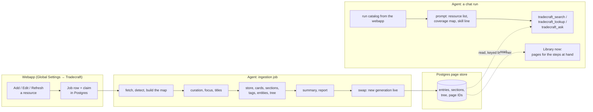

# README.TRADECRAFT

How **Tradecraft** works, end to end: the personal library of hacking-knowledge sites that the agent searches and
reads during an engagement.

This document is for users who want to understand what happens when they add a resource, and for developers who
change the code. The screens are described in the wiki pages
[Tradecraft Lookup](https://github.com/samugit83/redamon/wiki/Tradecraft-Lookup) and
[Global Settings → Tradecraft](https://github.com/samugit83/redamon/wiki/Global-Settings#tradecraft). Security rules
are summarised in [README.SECURITY_POSTURE.md](README.SECURITY_POSTURE.md), the tables in
[README.POSTGRES.md](README.POSTGRES.md).

---

## Contents

- [What Tradecraft is](#what-tradecraft-is)
- [The big picture](#the-big-picture)
- [Where the code lives](#where-the-code-lives)
- [Resources](#resources)
- [Ingestion: jobs and the pipeline](#ingestion-jobs-and-the-pipeline)
- [Settings](#settings)
- [The ingestion focus](#the-ingestion-focus)
- [Site logins](#site-logins)
- [The Map view and curation](#the-map-view-and-curation)
- [Projects](#projects)
- [In the agent's run](#in-the-agents-run)
- [The page store](#the-page-store)
- [Upgrading from Tradecraft 1.x](#upgrading-from-tradecraft-1x)
- [Operating it](#operating-it)
- [Testing](#testing)
- [Known limits](#known-limits)
- [Glossary](#glossary)

---

## What Tradecraft is

Each account keeps its own catalog of **resources**: sites it trusts for attack techniques, payloads and PoCs
(PayloadsAllTheThings, HackTricks, a CVE PoC archive, a vendor's documentation, a PDF, a blog). RedAmon
**ingests** each resource in the background: it maps the site's pages, gives each page a card (title, place in the
site, headings, a one-line description, tags), and, for a **Stored** resource, keeps the cleaned text of every page in
the RedAmon database. During a chat, the agent reaches the library through three tools:

| Tool | What it does | Model cost |
|---|---|---|
| `tradecraft_search` | Searches the library's cards and stored sections, or browses one level of a resource's tree | none |
| `tradecraft_lookup` | Reads one section of one page, by its page ID (or by a resource and a query), or one CVE of a CVE archive | none |
| `tradecraft_ask` | The **librarian**: for a vague need, searches, reads the promising sections and answers up to three checked pages with exact excerpts | the owner's *Tradecraft librarian* model |

Three things make it different from a web search:

- **You curate the sources.** The agent reads only the sites in your library, and only those turned on for the
  project.
- **The library describes itself.** Each resource has a summary written from its own pages, and the agent's prompt
  carries the resource list and a map of what the library covers, so the agent knows when the library can help and
  when to use `web_search` instead.
- **It is cheap at run time.** Search and reading call no model; the librarian runs only when the agent asks and the
  owner allowed it.
- **It follows the attack.** When a page fits, the agent's think step ends its prompt with **Library now**, the
  library's best pages for the step in progress and the next one, found by code with no model call.

---

## The big picture



There are two separate halves:

- **Ingestion** runs when a person adds, edits, refreshes or converts a resource. It is a background job on the agent
  (seconds to tens of minutes), it may call the resource's model (crawl decisions, tagging, the summary), and it
  writes a new **generation** of the resource's map, swapped in only when the job succeeds.
- **The query side** runs inside a chat. It reads the live generation of the resources the run may use. Nothing it
  does writes to the library: a read never stores a page.

Nothing runs on a timer: every ingestion starts from a person's action (or, once, from the conversion of 1.x
resources after an upgrade).

---

## Where the code lives

| Part | Path |
|---|---|
| The settings spec (every setting, its scope, default, range and ceiling; the code constants) | `webapp/src/lib/tradecraft/settingsSpec.json`, copied byte for byte to `agentic/tradecraft/settings_spec.json` by `webapp/scripts/gen-tradecraft-spec.mjs` (`--check` in the gate) |
| The vocabulary (topics, content kinds, recipes, keywords, technologies, synonyms) | `webapp/src/lib/tradecraft/vocab.json` → `agentic/tradecraft/vocab.json` (same generator) |
| The webapp ↔ agent contract | `agentic/tradecraft/contract.py` (pydantic) and `webapp/src/lib/tradecraft/agentContract.ts` (zod), held together by the fixtures of `agentic/tests/fixtures/tradecraft_contract/` |
| Resource routes (the account's own) | `webapp/src/app/api/users/[id]/tradecraft-resources/**`, `webapp/src/app/api/users/[id]/tradecraft-settings/route.ts` |
| Project routes | `webapp/src/app/api/projects/[id]/tradecraft/route.ts` (the accordion and the counter); `tradecraftOff` in the project's own `GET`/`PUT` |
| The run catalog (internal) | `webapp/src/app/api/internal/agent/tradecraft/catalog/route.ts`, policy in `webapp/src/lib/tradecraft/catalog.ts` |
| Webapp logic | `webapp/src/lib/tradecraft/` (`v2/` holds create, update, refresh, remove, list and the field parsers) |
| Screens | `webapp/src/components/settings/tradecraft/` (the tab, the cards, the form, the two dialogs, the Map view); `webapp/src/components/projects/ProjectForm/sections/TradecraftResourcesAccordion.tsx` |
| Agent routes | `agentic/tradecraft/api.py` (`/tradecraft/v2/*`) |
| Jobs and ingestion | `agentic/tradecraft/jobs.py`, `agentic/tradecraft/ingest/` |
| The page store | `agentic/tradecraft/db.py`, `store.py`, `schema_columns.py` |
| The query side | `agentic/tradecraft/agent_tools.py`, `runtime.py`, `overlay.py`, `library/`, `librarian/` |
| The conversion of 1.x resources | `agentic/tradecraft/convert.py` |
| The web boundary | `agentic/tradecraft/net.py`: the only module that reaches the web; `clock.py` the only source of time |

---

## Resources

### Adding a resource

**Global Settings → Tradecraft → Add Resource** opens the resource form. Its main fields:

| Field | Notes |
|---|---|
| **Name** | Free text. |
| **Resource ID** | The slug the agent names the resource by (`patt`, `hacktricks`). Made from the name, editable while adding, **fixed afterwards**. Unique in the account. |
| **URL** | `http(s)` only; no login inside the URL (`https://user:pass@…` is refused, `userinfo_refused`); private and internal addresses are refused by the same address guard the agent applies to every request. Unique in the account. |
| **Site type** | **Auto** (detected at ingestion) or forced: wiki (MkDocs/mdBook), docs site (Sphinx/Docusaurus), GitBook, GitHub repository, CVE archive, PDF, website. A forced type shows its own options (branch, folders, file types, sitemap URLs, menu selector, search index, PDF page range and chapters, CVE path patterns, start pages, pagination). |
| **Storage** | **Live** or **Stored** (see below). The form shows the type's recommendation; the account's default is in Configure ingestion. Next to Stored: "Stored keeps a copy of each page in your RedAmon database. Respect the site's terms of use." |
| **Model** | The owner's model for this resource's ingestion (crawl decisions, tagging, the summary). Required; never an Agent in the Loop (`loop/`) model, since no chat run drives an ingestion. |
| **Priority** | High, normal or low: a ranking boost in search. |
| **Focus** | What to keep (see [The ingestion focus](#the-ingestion-focus)). |
| **Access** | A GitHub token override and a site login (see [Site logins](#site-logins)). |
| **Overrides** | Per-resource values of the account's ingestion settings, section by section: each field shows *Inherit* with the account's value, or its own value. |
| **Summary** | Generated (the default) or written by hand; a written or locked summary is never replaced by an ingestion. **Regenerate** asks for a new one now. |

**Check URL** (in the form) asks the agent what the URL is before anything is saved: the start page's problems, the
detected type, the type's index (a sitemap, including one named by `robots.txt`; a repository tree with its branches
and tags; a docs site's search index, or the sitemap its map falls back to; a PDF's page count), whether the page
needs the browser, what `robots.txt` allows,
the recommended storage mode and an estimated size, and for a CVE archive the first path pattern that finds a CVE id
its README or first listing names. It calls no model and writes nothing (`agentic/tradecraft/check_url.py`).

**Quick Add** lists the curated presets (`webapp/src/lib/tradecraft/presets.ts`), with a *Featured* group first. A
preset fills the form, some with their own settings; the resource records the preset's stable key (`presetKey`) and
keeps its own copy of the values, so a later change of the preset changes no existing resource.

An account holds at most **200 resources** (`constants.maxResourcesPerUser`). Saving creates the row and starts an
`add` job; the card shows its progress at once.

### Live and Stored

| | Live | Stored |
|---|---|---|
| What the database keeps | the map and the cards (titles, headings when known, descriptions, tags), no page text | the map, the cards and the cleaned text of each page, split by headings into sections |
| A read | downloads the page from the site at each read (`source: live`) | returns the stored copy (`source: stored copy from <date>`); a page past the storage limits is read live (`source: live (not stored)`) |
| Search | cards only | cards and the text of every stored section |
| A refresh | builds the map again | builds the map again and stores again only the pages that changed (incremental refresh) |

The **default is Live** (`storage.defaultMode`): it keeps no copy of a third-party site unless the person chooses to.
Two types are fixed: a **PDF is always Stored** (its pages are read once from the document), a **CVE archive is never
stored** (its index holds no text; a CVE's file is read live from the archive at each lookup).

Storage limits (Configure ingestion → Content storage, all with ceilings): pages per resource (2,000), size per page
(200 KB; a longer page is cut), size per resource (50 MB), and the account's quota (1 GB, at most 10 GB). Above them
the install has its own ceiling of 20 GB of stored text across all accounts (`constants.instanceStoredBytesCeiling`).
When a limit is reached, storing stops and the rest of the pages are read live; the report counts them.

Switching **Stored → Live** deletes the stored text at once. **Live → Stored** marks the resource stale: its pages are
stored at its next refresh.

### Site types and how the map is built

| Type | Detected by | The map comes from |
|---|---|---|
| Wiki (MkDocs, mdBook) | the generator's markers | the sitemap (custom URLs and the `Sitemap:` line of `robots.txt` too), else `mkdocs.yml`'s navigation, else the site's menu |
| Docs site (Sphinx, Docusaurus) | the generator's markers, or a Read the Docs host; a file named `searchindex.js` counts only beside a mark that only Sphinx writes, and never under another tool's generator meta (a Hugo site) | the search index (`searchindex.json`, `search-index.json`, `searchindex.js`, or a custom URL; read up to 10 MB); when it lists nothing, the sitemaps inside the resource's folder; when they list nothing but the start page, a crawl (below) |
| GitBook | the generator's markers | the sitemap, else the menu |
| GitHub repository | the host and path | the repository tree on the chosen branch or tag, the chosen folders and file types; optionally one entry per folder with a README |
| CVE archive | a GitHub page naming more distinct CVE ids than `detection.cveArchiveThreshold` (20) | an index of its CVE files, with a GitHub token ([below](#a-cve-archives-index)); a lookup reads one CVE's file by the path patterns (`{year}/{cve}.md`, `{year}/{cve}/README.md` by default), else the year folder's listing, else (optionally) the repository README |
| PDF | the content | the pages in the chosen range, or the chapters of its bookmarks |
| Website | anything else | the crawl (below) |

A detector can be turned off for the account (`detection.enabledDetectors`), and a homepage with too little text is
treated as a website (`detection.thinHomepageChars`). The map of each type stops at its own limit
(`knownTypes.maxMapEntries.*`). A sitemap index of per-language copies (most of its children named by an ISO 639-1
code) is read in the language the map keeps first (`knownTypes.language`: *Auto* the resource folder's language, then
English; *Preferred* the person's; *All* the listed order), and the other languages only when those list nothing. A
title guessed from a URL is percent-decoded once and kept on one line.

**A docs site's map** (`builders.build_docs`) tries its sources in order, in one time budget
(`crawl.timeBudgetSec`) that a cancel also ends: the search index; else the sitemaps, kept to the resource's host and
folder (below the site root the folder's own `sitemap.xml`, then those `robots.txt` names, then the site's
`/sitemap.xml`; at the root those `robots.txt` names first), passing over one that lists only the start page or an
alias of it; else the crawl a website gets, model-guided where the strategy is *Auto*, inside the folder, at the docs
map limit, on the time the reading left. A docs map left with only its start page fails the refresh (`timeout` when
the time budget ran out, else `fetch_failed`; `docs_start_page_only` is counted), so the previous version stays. The
report's stop reason names the source: `docs: searchindex (N pages)`, `docs: no search index, sitemap.xml|robots|site
sitemap (N pages)` (either with `, map limit`, a sitemap's also with `, time budget`), `docs: no search index or
sitemap, crawl (<the crawl's code>)`, `docs: no search index, time budget`.

### A CVE archive's index

A CVE archive's map is an **index of its CVE files** (`builders.index_cve`): one entry per CVE, whose title and entity
are the CVE id and whose URL is the raw file the reader reads first for it. An entry holds no text, so nothing is
downloaded or stored; it lets [`tradecraft_search`](#tradecraft_search) and [Library now](#library-now) find a CVE
the archive holds.

- **Only with a GitHub token.** The listing carries the job's GitHub token (the resource's own, else the account's
  *GitHub Access Token* of Global Settings → API Keys), sent to GitHub's hosts only. Without one there is no index and
  no call is made for it: GitHub allows 60 unauthenticated API calls an hour from one address, and a full archive's
  index takes about one per year folder. The archive is then read by CVE id only, and the report's stop reason reads
  `cve index: add a GitHub token to index this archive` (`cve_index_needs_token` among its errors).
- **How it lists.** One git trees listing per year folder (the contents API stops at 1,000 entries of a folder),
  newest year first, parsed on the job's thread pool; a path pattern with a folder before `{year}` costs one listing
  more. Every listing answer, the root's and that folder's included, is read up to 10 MB
  (`builders.CVE_LISTING_MAX_BYTES`, `constants.sitemapMaxBytes`). A CVE counts once, at the first of the archive's
  path patterns that names its file, and only where the reader builds exactly that path for it (ASCII digits only). A
  pattern whose first placeholder is not a `{year}` folder adds no entry; its CVEs are still read by id. An archive
  none of whose patterns names a year folder has no index at all, with or without a token: the report counts
  `cve_index_no_year_pattern` (not `cve_index_needs_token`), its stop reason reads `cve index: none, no path pattern
  names a year folder`, it is read by CVE id only, and its card shows no notice (no token or refresh would change
  it).
- **The cap.** At most 20,000 entries, the map ceiling every site type shares (`knownTypes.maxMapEntries.*`): over it,
  the largest files are kept (in a proof-of-concept archive a CVE's file grows with the PoCs it lists), and the stop
  reason reads `cve index: largest 20000 of <N> files`. A CVE left out is still read by `cve_id`.
- **Folders not listed, or listed in part,** are counted in the report by cause: `cve_index_folder_unread` (an error, a rate limit, an
  answer that is not a tree; a GitHub rate limit also stops the listing), `cve_index_listing_cut` (a listing answer
  over the size bound, the root's, a folder's before `{year}` or a year's tree, or a tree GitHub cut; never a miss), `cve_index_time_budget` (the crawl's time budget, `crawl.timeBudgetSec`, ran out) and
  `cve_index_folder_missing` (a folder a pattern names before `{year}` that the repository does not have: it holds
  nothing). The stop reason adds `, <n> folders unread` for the folders not listed at all (an error, a rate limit, an
  answer over the size bound, the time budget, a cancel); a tree GitHub cut is listed in part and a missing folder
  holds nothing, so neither counts there.
- **The stages** pass an archive's entries by: no tags, focus judgement, content check or model call, no tree; the
  entity is the file's CVE id; the summary reads the homepage, not the map's titles; the report has no readiness line.
  Browsing an archive with `tradecraft_search` lists no CVE ids; it says to read a CVE by `cve_id`.
- **Page IDs.** Each entry gets a page ID like any page. When the largest 20,000 change between refreshes, the IDs of
  the files that left stay unused (an ID is never reused), so an archive's page IDs grow with its refreshes, bounded by
  its file count.

**Crawling a website** (`agentic/tradecraft/ingest/crawl.py`) has three strategies (`crawl.strategy`):

- **LLM-guided** (the default): fetch a page, keep it when it has a title and enough text, offer its links to the
  resource's model, follow the ones it picks, until a limit or the model says stop;
- **Rule-based**: the same loop with no model: every link the rules allow is followed;
- **Auto**: the site's sitemap (named by `robots.txt`, else `/sitemap.xml`) becomes the map without visiting the pages;
  with no usable sitemap, the LLM-guided crawl.

The **follow rules** apply before any model decision and to every page the map keeps: exclude patterns (they match at
the start of any path segment; `login`, `signup`, `privacy` and similar by default), include patterns, staying in the
starting folder, the host scope (exact, with `www`, or every subdomain), links with a query string (keep, drop, keep N
per path), and, when turned on, `robots.txt` (RFC 9309: a 4xx allows everything, a 5xx or no answer disallows
everything). The crawl's limits: pages opened, model calls, time, depth, links offered per page; a delay between
requests and up to 8 requests in parallel. Extra start pages, a custom sitemap and pagination (`page/N`) are per
resource. Each skipped page is counted by reason (`excluded`, `outOfScope`, `tooLittleText`, `robots`, `outsideFocus`).

**Fetching.** A page is first downloaded with a plain GET. When it gives too little text, or the resource asks for it
every time, it is rendered in the sandbox browser, which cleans it in the page before the transfer (body selector,
removed elements). The browser is never used for a resource with a login. Every plain request passes the address guard
on every redirect hop, judged on the address it connects to; the browser runs a guard script that aborts navigations and
resources aimed at internal addresses (its residual, a blind request on a redirect hop, is in
[README.SECURITY_POSTURE.md](README.SECURITY_POSTURE.md) §11), and a refused page is never retried in it.

### The resource card

Each resource is a card in **Global Settings → Tradecraft**:

- the name, Resource ID, type, Live or Stored, Enabled;
- while a job runs, its **stage** (fetching, building the map, storing, tagging, summarising…) and **Cancel** in place
  of Refresh;
- the last successful ingestion's report as a short line (pages visited and kept, why the crawl stopped), which opens
  into the full report; a failed or cancelled job reads `Failed (<error code>): the previous version is kept` or
  `Cancelled: the previous version is kept` (the codes are under [Operating it](#operating-it)), and **Refresh** tries
  again;
- **Ingested with older settings** when the resource's live version was built with other settings, another forced type,
  another focus or another login shape than it has today; its next refresh applies them;
- **Ingested before 2.0: refresh for headings, descriptions and search inside pages** on a resource converted from 1.x;
- on a CVE archive with no [index](#a-cve-archives-index), read from its last report (`cveIndexHint` in
  `webapp/src/lib/tradecraft/client.ts`): **Add a GitHub token to index this archive: the GitHub Access Token in
  Global Settings > API Keys, or the GitHub token override in Edit > Access, then refresh** when that ingestion had
  no GitHub token (the report counts `cve_index_needs_token`) and the resource has no token of its own; **Refresh to
  index this archive** when the resource has its own token since, or when the ingestion did not reach the index (one
  from before the index existed). Both carry the tooltip "An index lets search and Library now find the CVEs this
  archive holds; without one, a CVE is read only by its id." A token added on the account shows only after the next
  successful refresh (a failed one keeps the old report). An archive with no report yet (a first ingestion, or one
  converted from 1.x, which reads *Ingested before 2.0*), an indexed one and one whose path patterns name no year
  folder show neither;
- **Map** (the Map view), **Edit**, **Delete**.

The tab also holds **Add Resource**, **Configure ingestion**, **Configure search**, the librarian model line ("Librarian
model: <name> (change)") and, while the librarian is in use and no model is set, the **No librarian model** banner.

### Editing a resource

What an edit does depends on the field (`webapp/src/lib/tradecraft/v2/update.ts`):

| Change | Effect |
|---|---|
| Name, model, priority, summary | saved; no ingestion |
| Enabled | saved; forgets every project's choice for the resource (it is then on in every project, or off everywhere) |
| Site type, overrides, focus, Live → Stored | the resource becomes **stale**; its next refresh, or **Save & re-ingest**, applies them |
| URL | checked like a new one and ingested again at once |
| Stored → Live | the stored text is deleted at once |
| The login | applies to the next request (and is audited) |
| Resource ID | cannot change |

A change of the URL, the storage mode or the login waits for a running job: the save answers 409 `job_running` and
writes nothing until the job ends or is cancelled.

### Refreshing

- **Refresh** (on the card) starts a `refresh` job with the resource's current settings. The previous version stays
  live until the new one is swapped in; a cancel or a failure keeps it. With *When a refresh fails or comes back empty*
  at **replace** (`refreshing.onFailure`), a failed or empty result replaces it instead.
- **Save & re-ingest** (the form) saves and refreshes in one step.
- **Save & refresh all** (Configure ingestion) saves the account's settings and refreshes every resource the person
  confirms, one job each, one at a time. The batch stops when the daily model budget is used up, so the chats keep
  their calls; each resource not refreshed keeps its previous version and reads "Not refreshed: the daily model budget
  is used up; the previous version is kept".
- **Incremental refresh** (`storage.incremental`, on by default) applies to Stored pages: a page whose site answers
  304 to the conditional request (its ETag or Last-Modified), or whose text is identical, is not stored again; it is
  copied forward with its sections, headings, description, tags and entities, and no model call is made for it. A 304
  is trusted only when the page was stored with the same settings.
- **A failed map fails the refresh** (`pipeline.failure_code`) whatever pages the person pinned: curation adds pins to
  any map, an empty one included. A GitHub repository whose API does not answer fails with `fetch_failed`, so its
  previous tree stays; a docs map with only its start page fails too ([above](#site-types-and-how-the-map-is-built)).
- **A CVE archive's index** (`pipeline._incomplete_cve_index`, `_budget_cut_cve_index`). A folder missed this time
  (`cve_index_folder_unread`) fails the refresh of an archive that is already readable with `fetch_failed`, so the
  previous index stays; on a first ingestion the listed part goes live. A cut by the time budget (newest years first,
  so the oldest are left out) fails the refresh with `timeout` while the previous index is whole; it goes live when
  the archive had no index, when the live index was cut by the budget too, or when the last refresh already failed
  with that `timeout` (a listing the budget never fits would otherwise keep an old index for ever). A folder over the
  size bound, cut by GitHub or missing would be the same at the next refresh: it is counted and the rest goes live. A
  refresh with no GitHub token builds no index, so the archive keeps none after it and is read by CVE id only.

### The ingestion report

Every job writes a report (counts and codes only, never a URL or page text): pages visited and kept, pages skipped by
reason, why the crawl stopped (in words, for example "stopped: auto: robots (21 pages)"), model calls, duration, pages
stored and not stored (by size, by quota), the focus's counts, errors by code, and, for every type but a CVE archive,
a **readiness** line: the share of kept pages with a real title, with headings, with a description and with a topic.
When one is low, the report
suggests a fix: Stored mode for a Live resource (a stored copy gives every page its headings and a description), a
focus with content checks for a Stored one.

### Deleting

- **Deleting a resource** cancels its running job, then removes the row; the database cascade removes its entries,
  sections, tree, page IDs, curations, jobs and project choices. A job that ends later finds no resource and writes
  nothing.
- **Deleting or disabling an account** cancels its unfinished jobs first (`webapp/src/lib/tradecraft/deleteCleanup.ts`,
  and the `cancel_tradecraft_jobs` step of the revocation plans); the cascade then removes everything the account
  held.

---

## Ingestion: jobs and the pipeline

### Jobs

A job is a row of `tradecraft_ingestion_jobs` (kinds `add`, `refresh`, `reingest`, `bulk`, `regenerate_summary`,
`convert`, `pdf_convert`). The webapp writes the row with a 60-second start lease and **claims** the resource for it
(`activeJobId`) in one transaction, then asks the agent to run it (`POST /tradecraft/v2/jobs`). The agent's job runner
(`agentic/tradecraft/jobs.py`):

- keeps one FIFO queue per owner, runs at most **2 jobs per agent copy** and **1 per owner** at a time, and accepts at
  most 200 queued jobs per owner (`queue_full`);
- renews the lease of every job it holds, queued or running, every 20 seconds; a job has no time limit of its own,
  only its lease and the crawl's limits;
- reads **Cancel** as a database flag between pages, so any copy of the agent (or the webapp) can cancel any job;
- at boot, fails the jobs whose lease expired (`agent_restarted`); a webapp start of a new job on a resource whose job
  lost its lease fails the old one (`agent_lost`).

Every way out of a job releases the claim. The job runs on its own thread pool (`tradecraft-ingest`) for parsing, and
on the agent's own Postgres pool of at most 5 connections, so a busy library never takes connections the rest of the
stack needs.

### The pipeline

`agentic/tradecraft/ingest/pipeline.py` runs one job's stages in order (`contract.JOB_STAGES`):

```
fetch_home → detect → build_map → curation → focus → titles → incremental → store → cards → sections
→ tags → entities → tree → content_check → write → summary → report → legacy_map → swap
```

| Stage | What it does |
|---|---|
| `fetch_home`, `detect` | the start page and the site type |
| `build_map` | the type's builder, or the crawl |
| `curation` | the person's blocks, pins, restores and renames (see [The Map view](#the-map-view-and-curation)) |
| `focus` | the ingestion focus's selection |
| `titles` | real page titles, when turned on (`knownTypes.realTitles`): the page's `<h1>` or `<title>` (a repository file's first heading), at most `knownTypes.maxTitleFetches` downloads |
| `incremental` | which stored pages are unchanged |
| `store` | the cleaned text of a Stored resource's pages, within the limits |
| `cards` | one card per page: title and its source, breadcrumb, headings of levels 1-3, a one-line description; for a Live wiki, GitBook or docs site, a card pass reads up to 500 pages for their headings without keeping the text |
| `sections` | a stored page split by its headings (levels 1-3; a code block is never split; stable anchors) |
| `tags` | topics, content kinds and technologies from the vocabulary's rules; the pages the rules leave without a topic go to the model (`focus.tagEveryPage`) |
| `entities` | CVE ids and technology, product and tool names, from the page only, never from a project's recon |
| `tree` | the folders, or virtual topics for a flat site, with page counts and one-line folder descriptions |
| `content_check` | the focus's page-by-page check |
| `write`, `summary`, `report` | the generation's rows, the summary, the report |
| `legacy_map` | the 1.x columns (`sitemap`, `resource_type`, `crawl_stats`, `crawl_stopped_because`), kept current so an install rolled back to 7.8.0 reads them |
| `swap` | the new generation becomes the live one, in one transaction on the resource and job rows; the old one's rows are deleted afterwards in batches |

**The summary** is one model call with the start page's text, the map's titles and the person's extra instructions, as
untrusted content; with a Focused focus it describes the subset kept. A written or locked summary is kept, and a failed
call keeps the previous one.

**Model calls** go to the resource's model, built from the owner's providers with the purpose label
`tradecraft_ingest`, and count against the owner's daily budget. No call is retried. A call the daily budget refuses
(`llm_budget_exhausted`) fails the job, so the previous version stays live rather than a smaller map.

---

## Settings

Every setting is defined once, in the spec (`settingsSpec.json`: 95 settings in 15 sections, plus the code constants),
with its scope, its level (account, resource or both), its default, its range and its **ceiling**. A ceiling is a
security limit: the webapp checks it on save, and the agent clamps every value again (`agentic/tradecraft/settings.py`),
because the JSON columns have more than one writer. No setting is an environment variable.

| Where | What |
|---|---|
| **Configure ingestion** (account) | Fetching, Site detection, Known site types, Website crawl, Content storage, Summary, Refreshing, Ingestion focus (with *My focus recipes*); a live estimate of the worst-case time and model calls of one crawl; **Save**, **Reset**, **Save & refresh all** |
| **Configure search** (account) | Librarian (its use, model calls, pages, time limit, questions per run, and the model through the gate), Search (results, the attack session, match strictness, *My synonyms*), Reading pages, What the agent sees in its prompt, Hints during the attack ([Library now](#library-now) on or off); each resource's priority; a live estimate |
| **The resource form** (resource) | the overrides of the ingestion settings, the type's own options (`type.*`), the content selectors |
| **Models by feature** | *Tradecraft librarian* (the librarian's model) |

The account's row (`tradecraft_user_settings`) holds only the values a person changed, so a default changed in a later
release reaches every account that never touched it. A key the spec no longer has (`hints.perRun`, "Hints per run") is
ignored when a request sends it, never refused, and the next save of the search settings drops it from the row
(`REMOVED_KEYS` in `settingsSpec.ts`). A job carries the **effective settings**: the spec's defaults, the
account's values, then the resource's overrides; the hash of what shaped the map is recorded at the swap, and a later
difference shows **Ingested with older settings**.

---

## The ingestion focus

A resource's focus (`focus` in the form; the account's defaults in Configure ingestion → Ingestion focus) says what to
keep:

| Mode | Effect |
|---|---|
| **Everything** (the default) | every page the rules allow is kept |
| **Focused** | only pages that serve the chosen **topics** (the attack skills and a few more: Active Directory, cloud, privilege escalation, mobile, wireless, containers and Kubernetes, network services) and **content kinds** (payloads, bypasses, techniques, tool commands, PoC, write-ups, theory, detection), minus what *Skip* names |
| **Tag only** | nothing is dropped; every kept page is triaged and tagged from the full lists |

In Focused mode (`agentic/tradecraft/ingest/focus.py`): a free **keyword pre-sort** ranks the pages by title and path
(with **Strict**, a page with no link to the focus is dropped here); a **title triage** sends titles and paths only to
the resource's model, 100 at a time, inside an untrusted block, and reads a fixed JSON answer; with content checks on,
the pages it marked *maybe* (every kept page with Strict) get a **content check**: the model reads their first 2,000
characters and answers keep or drop with a one-line description, at most `focus.maxContentChecks` pages per resource.
A pinned page is never dropped, a dropped page keeps its reason (the Map view's *Dropped* filter), and a model error
drops nothing. The crawl reads the focus too: links that name it are followed first, and the summary describes the
subset kept.

**Preview** (in the form) runs the pre-sort and one triage call on up to 100 entries of the resource's map, or of the
page list Check URL found, and shows each decision with its reason. It writes nothing. **Recipes** (*My focus recipes*,
at most 50 per account, plus the shipped ones) fill the topic and kind chips.

---

## Site logins

A resource can carry a login for a site that needs one: a **cookie**, up to 20 **custom headers**, and **basic
authentication** (form → Access). The rules (`webapp/src/lib/tradecraft/v2/fields.ts`, `actAs.ts`, `catalog.ts`;
`agentic/tradecraft/ingest/fetch.py`):

- **Masked everywhere.** No answer ever returns a value: a set secret reads `"set"`, and a request that sends `"set"`
  back keeps the stored value; no write and no agent request accepts `"set"` as a value.
- **Only to its own host.** The login goes only on requests to the resource's own host (its URL's host, and its http to
  https upgrade), hop by hop: a redirect to another host never carries it. Header names are checked (an HTTP token;
  never `Host`, `Content-Length`, `Transfer-Encoding`, `Connection`, `Cookie` or `Authorization`, which have their own
  fields), values never hold a line break.
- **Never the browser.** A resource with a login is read with plain HTTP only; "always use the browser" is not offered.
- **Only in the owner's own runs.** A resource with a login is in the run catalog only when the run's person is its
  owner and no administrator acts as them. In a project shared with others it shows to them as *Owner only*, locked,
  and only the owner's own session changes its project choice. Its pages are read only within its map (a kept entry,
  or a pin on its own host).
- **Act-as.** While an administrator acts as the account, the login stays masked, and a run they start never gets the
  resource (above). What else holds depends on the account and on `RBAC_PERMISSIONS_ENABLED`:

  | | Account that can sign in (has a password) | Passwordless managed account |
  |---|---|---|
  | Writes: Add, Edit, Refresh, Save & re-ingest, Check URL, the focus preview, Save & refresh all, curation, a change of the login | refused, 403 `own_account_only` (the account's own data is written only by the account), no `act_as.refused` row, whatever the switch | allowed; with the permissions switch on, a write that would use the login is refused (403 `not_while_acting_as`, `use_site_logins`) and a change of the login too (`change_site_logins`), each with an `act_as.refused` row |
  | Reads of a login resource: View (its stored page text), Read now, the Map view | with the permissions switch on: View and Read now refused (`use_site_logins`, `act_as.refused`), the Map view titles and URLs only | the same |
  | The same reads with `RBAC_PERMISSIONS_ENABLED` off | allowed: the admin reads the stored page text, runs Read now (which sends the login) and sees the whole map | the same, and the writes above use and change the login too |

  The GitHub token keeps its own refusal (`use_github_token`).
- **Audited.** Adding, changing or removing a login writes `tradecraft.credentials_changed` with the names of what
  changed, never a value.
- Check URL and the focus preview accept the login being typed, before it is saved.

The **GitHub token** follows the same masking. A resource's own override is used in every run; with none, the agent
sends the run owner's account token (`runtime.run_github_token`), and only to the GitHub hosts over https.

Logins are stored in Postgres like the GitHub token, not encrypted (see [Known limits](#known-limits)).

---

## The Map view and curation

**Map** (on the card or in the Edit form) shows the resource's live map (`webapp/src/components/settings/tradecraft/MapView.tsx`):

- search by title or URL, filter by tag, the count and the sources;
- **View** a page's stored text (plain text, with its date), **Open** it on the site (http(s) only), **Read now** (the
  agent downloads it the way its tool reads it, within 45 seconds, and keeps it nowhere);
- **Pin** a URL (it joins the map at the next refresh; on a login resource, its own host only);
- **Block** one page, the ticked ones, or every page matching the search (the count is confirmed; a changed count
  answers 409 and is shown again): the stored text and sections go at once, and the read path refuses the URL from any
  source; **Unblock** brings it back at the next refresh;
- **Rename** (shown at once, applied at the next refresh);
- the **Dropped** filter with each page's reason, and **Restore** (kept now and pinned, so the next refresh keeps it).

Curations are stored by URL (`tradecraft_curations`) and outlive every refresh. A project's accordion opens the same
view read-only (**Pages**, for the owner).

---

## Projects

A resource is used in a project when it is **Enabled** in Global Settings and nobody turned it **off in that
project**. A project can only turn a resource off: a row of `tradecraft_project_choices` means off, no row means on.

- **The project's settings, Agent Skills & Tradecraft tab**, and the chat drawer's window of the same name, hold the
  **Tradecraft Resources** accordion: each resource with its switch (**Turn all on**, **Turn all off**), its type, Live
  or Stored, focus, login, the counts the next message will use, the librarian model or its warning, and, for the
  owner, read-only details, the full report and **Pages**. A change saves with the project (`tradecraftOff`, which needs
  `project:settings` like the skill switches) and applies from the next message.
- **The counter badge** in the chat's phase bar shows how many resources the next message will use; its tooltip warns
  when the librarian has no model.
- **Turning a resource on or off in Global Settings** (Enabled) resets every project's choice for it, after an alert
  that names the projects it changes (`enabled-impact`).
- **Who sees what.** The owner sees every resource with its details; an administrator acting as the owner sees the
  same except the summary of a resource with a login (its URL, report, focus, ingested-with settings and last error
  still show, and **Pages** lists its page titles and URLs); anyone else who reads the project (a collaborator,
  oversight, break-glass) sees names and on/off only, and a resource with a login as *Owner only*.
- **An ownership transfer** clears the project's choices (the resources were the old owner's).
- **The Tool Matrix** row of `tradecraft_lookup` carries a note: `tradecraft_search` and `tradecraft_ask` follow its
  phases.

---

## In the agent's run

### The run catalog

At the start of each run, the agent asks the webapp for the run's catalog
(`GET /api/internal/agent/tradecraft/catalog?projectId=…`, internal key; the person and the acting administrator are
sent, the owner is read from the project row): the resources active in the project for this person, each with its
effective read settings and secrets, and the owner's search settings. The catalog names no map and no generation:
every read takes the resource's live generation at that moment, so a refresh that swaps during a run is seen at the
next call.

The catalog is bound to the run's task only (`agentic/tradecraft/runtime.py`). No catalog, an unknown project, or an
error leaves the run without the tradecraft tools. The tools are offered in the phases the Tool Matrix gives
`tradecraft_lookup`: all three by default (`agentToolPhaseMap` in `schema.prisma` and `DEFAULT_AGENT_SETTINGS` in
`agentic/project_settings.py`), since they read only the owner's library and its resources' own sites, never the
target. `tradecraft_search` and `tradecraft_ask` follow them, and `tradecraft_ask` only while the owner's *Librarian
use* is **Agent decides**. The agent reads a project's stored map as it is, never merged with the defaults, so a
project keeps the row it was saved with (see [Upgrading](#upgrading-from-tradecraft-1x) for the one-time move of the
old default). They are never offloaded to a sub-agent.

### What the agent sees in its prompt

The tools' registry entries (`agentic/tradecraft/overlay.py`) carry:

- **the resource list**: with *Auto* (the default), each resource's full summary while the run has at most 10
  resources, then one line each (name, type, a scope of 12 words cut from the summary by code); *Full* and *One line*
  force either;
- **the decision guide**, which tool and never when, with no trigger tied to a topic: a page shown in the prompt or an
  earlier result fits the step, `tradecraft_lookup(page=…)`; a need the agent can name, `tradecraft_search` then
  `tradecraft_lookup`; it cannot tell what fits, or search shows only related pages, `tradecraft_ask` when offered
  (else read the closest by section, or refine); clearly outside what the resources cover, `web_search`;
- **the coverage map** (`prompt.coverageMap`, on by default): page counts by topic, kind and technology, with *Not
  covered*, from one bounded query at the run's start (counts and fixed vocabulary names only, never a page title).

Elsewhere in the prompt:

- **the skill line** (`library.coverage.skill_line`, placed by `agentic/prompts/__init__.py`): when the run's attack
  skill is a topic the library covers, its pages for that topic, just before the skill's playbook;
- **rules 6 and 7** of the main instructions' *Important Rules*, and **Library now** at the end of the think step's
  system message, where Library now runs ([below](#library-now)).

A run with no active resource (the owner has none, or the project turned them all off) sees no Tradecraft text at all:
no registry entry, no skill line, no rule, no Library now, and none of the prompt's static texts that name the tools
(the workspace rules' list of tools never spawned as jobs, the typed-arguments examples, the stealth rules' section),
which follow `overlay.offered_catalog()`.

### `tradecraft_search`

`tradecraft_search(query, resource?, topic?, kind?, technology?, path?)` (`agentic/tradecraft/library/search.py`).
A search runs up to **six wordings** of one need, with no model: the agent's words (full text over the cards and the
stored sections), their synonyms and acronyms (the shipped list plus *My synonyms*), the words within the current
skill's topic, within the target's technologies, the exact entities named (CVE ids, products, tools), and a fuzzy match
on titles. The results are merged by reciprocal rank fusion; the attack session (skill, phase, technologies) and the
resource's priority boost, never filter. The answer:

```
search: "<query>" · FOUND | RELATED | NOT FOUND · <shown> of <total> results
 1. patt:412  SQL Injection › PostgreSQL — Time-based blind payloads (payloads)
 ...
read: tradecraft_lookup(page="patt:412", section="...")
```

FOUND, RELATED or NOT FOUND follows the match strictness. With `path` and no query, it **browses** one level of a
resource's tree: folders with their page counts and descriptions, then pages; the root carries the resource's summary.

The agent's filters (`topic`, `kind`, `technology`) and the topic and technologies wordings' own filters apply before a
statement ranks, so the ranking reads only the pages that can come back.

**A CVE archive's index** is read apart from the wordings (`search.archive_entries`, the `archive_entries` statement
of `search_sql.py`): no text, entity or fuzzy wording reads it (every entry's title holds "cve" and its year, and a
fuzzy match would find a neighbouring id), only the CVE ids the query names. Each such id gives one row, however many
archives hold it: the archive of the highest priority, then the first slug; an entry the person blocked in the Map is
left out, so another archive's copy stands for it. The row is never cut by the merge, and it comes first among the
pages that name that id exactly. The librarian searches without the archives (`free_first_pass(archives=False)`), since
it cannot read them.

### `tradecraft_lookup`

`tradecraft_lookup(page?, section?, part?, resource_id?, query?, cve_id?, section_path?, force_refresh?)`
(`agentic/tradecraft/library/reader.py`) reads **one section** of one page at a time, at most `reading.charsPerRead`
characters (12,000 by default; a longer section is cut into parts at paragraph boundaries, never inside a code block).
The answer names the page, the section, the other sections and the source, and a section in parts says
`part: N of M` with the call that reads the next (`next: tradecraft_lookup(page="…", section="…", part=N+1)`).

The reads that return a whole text rather than a section (one CVE of an archive and its README fallback, a forced
`section_path`, a page the 1.x title match picks, a PDF page) keep the same limit: their text is cut into parts the same
way, their `next:` line repeats the read's own arguments with the next `part` (each text value quoted as JSON, so a
path or a query comes back exactly), and the list of code blocks follows the text only while it fits. A part that does
not exist is refused before the page counts as read. A refusal names the page by its ID or its URL, or the resource by
its slug, never by a title or a heading, which are the site's text and would sit outside the untrusted envelope (a CVE
archive's refusals of a page ID name the ID); the headings a missing section lists follow in an envelope of their own.
The read path:

1. the resource no longer exists → it says so, no request;
2. the page is blocked, or the resource has a login and the page is not in its map → refused, no request;
3. a Stored resource with a stored copy → the copy (`stored copy from <date>`);
4. otherwise → the page is downloaded and nothing is kept (`live`, or `live (not stored)`);
5. the site cannot be reached → an error that says whether a copy exists.

`resource_id` with `query` picks a page when the agent has no page ID; `force_refresh` reads a Stored page from its
site instead of its copy (and stores nothing). A resource not yet converted from 1.x is read through the 1.x title
match until its conversion.

A **CVE archive** is read one CVE at a time, live (`library/cve.py`): with `resource_id` and `cve_id`, or with the page
ID of its index entry, which reads that entry's CVE the same way, with the same parts and refusals. Both routes refuse
a file the person blocked in the Map before any request for it, matched on the archive's own URL for the file (never
GitHub's spelling of the repository), and a read marks the entry of the file it returned as read in the run, so Library
now does not show it again; the README fallback is no entry's. "PoC not found" is the answer when no path pattern, the
year folder's listing nor (optionally) the README has the CVE; a GitHub error says it is not a "PoC not found" answer.

### `tradecraft_ask`: the librarian

`tradecraft_ask(need, context?, want?, scope?)` (`agentic/tradecraft/librarian/`) runs a small LangGraph sub-graph
inside the tool call, then discards it:

```
shortlist (model) → inspect (no model) → judge (model) → FOUND / PARTIAL → answer
                                            └─ NONE, first round only → plan (model) → shortlist again
```

It reads up to 40 candidate cards from its own searches, opens at most `librarian.maxPages` pages (4), reads the 1-2
matching sections of each (3,000 characters each), and answers FOUND, PARTIAL or NOT FOUND with up to **three pages**,
each with an exact excerpt and a one-line reason. Every page ID must come from its own results and every excerpt must
appear word for word in the section it read; the whole answer is at most 6,000 characters, inside the untrusted
envelope. Limits (Configure search → Librarian): model calls per question (5), pages (4), a time limit (30 s; then it
answers PARTIAL with the best so far), questions per run (10).

- It runs on the owner's **Tradecraft librarian** model (Models by feature), built from the run's own providers, with
  the purpose label `tradecraft_librarian`; no fallback to the chat model.
- When the free first pass finds nothing, it answers NOT FOUND with no model call.
- It neither searches nor reads a CVE archive (its entries hold no text to quote); the agent reads one by `cve_id`.
- It **degrades to the plain search results**, with the reason, when there is no model, in an Agent in the Loop run,
  when the model cannot be built, on a model error, at the time limit.
- It never writes a checkpoint and never retries a call.
- **The gate.** While *Librarian use* is **Agent decides** (the default), adding a resource or turning one on needs a
  librarian model: the request answers `model_required`, and the screen opens a dialog that suggests one, saves it on
  confirm and sends the request again. With **Search only**, no model is needed and the tool is not offered.
- **In the chat**, a librarian result shows a trail line under it ("Librarian: searched 3 queries, inspected 4 pages,
  picked 2").

### Library now

**Library now** puts the library's best pages for the steps at hand at the end of the main agent's think call, found
by code at no model cost (`agentic/tradecraft/library/hints.py`, `profile.py`). It runs where the run has at least one
active resource, Configure search → *Hints during the attack* → *Hints* (`hints.enabled`) is on, and the Tool Matrix
allows `tradecraft_lookup` in the current phase (`hints.offered`). Fireteam members get none.

- **The steps at hand** (`profile.steps_of`) are the ones the agent is about to take: the todo item in progress and
  the next pending one, or the objective (the person's message) before there is a todo list; each one line of at most
  300 characters. A step is searched with its own words, without the URLs, addresses and bare numbers that name the
  target; the CVE ids it names stay whole. The CVE ids a confirmed finding names (a finding of a type that says a
  vulnerability is real, its `related_cves`) get a search of their own, the newest three.
- **When it searches.** At most one round of searches per think, waited for at most **8 seconds**
  (`SEARCH_TIMEOUT_SEC`). A step is searched once for the session's facts (the skill's topic, the phase, the target's
  technologies as vocabulary ids, the catalog's resources), and again only when those facts change, or when the agent
  read every page the search kept and it kept a full set (more may fit). A search that failed or did not answer in
  time is tried again at the next thinks, twice at most, and again after any later search succeeds; the step keeps the
  pages it had meanwhile. A run searches at most twice its iteration limit plus 10 distinct steps (never more than
  1,000).
- **What fits a step** (`hints.fits`). Each search is the free first pass of [`tradecraft_search`](#tradecraft_search).
  A page fits when the search's own scores make it related at the account's *Match strictness* (at *balanced*, half
  of the step's term groups found on the page), and the step is named where the page names itself: one of the step's
  terms, or a vocabulary topic the step names in any of that topic's phrases ("Directory Traversal" for "path
  traversal"), in its title, breadcrumb or file name. Its headings do not count: a long page's headings hold planning
  words ("Bypass Techniques") that any step uses. A page naming a CVE id of the step exactly, or a close fuzzy title,
  fits too; for a confirmed finding only an exact CVE id fits. A [CVE archive's entry](#a-cve-archives-index) for that
  CVE comes first.
- **The block** holds at most 3 pages (`constants.pagesPerHint`): the best page of each step in turn (the step in
  progress, the next step, then the confirmed finding), each under the step it fits, a page fitting two steps shown
  once. Each search keeps its best 6 not read yet, so the next ones step in as the agent reads, with no new search. A
  page the run read never comes back; one shown and not read may come back for another step. When nothing fits,
  there is no block.

The block:

```
Library now (pages for the steps at hand):
<<<UNTRUSTED_TRADECRAFT_RESULT id=…>>>
  step in progress: "Probe the search parameter for PostgreSQL time-based blind SQL injection"
    patt:412       PayloadsAllTheThings › SQL Injection › PostgreSQL Injection   matches: postgresql, time, blind
  next step: "Extract the users table with PostgreSQL stacked queries"
    hacktricks:88  HackTricks › Pentesting Web › SQL Injection › PostgreSQL injection   matches: postgresql, stacked
<<<END_UNTRUSTED_TRADECRAFT_RESULT id=…>>>
If one fits your next step, read it with tradecraft_lookup(page=…) before acting.
```

Each row is the page ID, the resource's name with the page's breadcrumb and title, and up to six words it matched: the
CVE ids and the words of the step the page holds, then the session's topic and technology names it is tagged with,
never a word of the page's own. No page text (a description, a section) is shown.

- **Notices**, fixed text after the block, or alone when there is none. A step that could not be searched, once it has no page left to show:
  "Library now: a step was not searched (search limit for this run); use tradecraft_search for it yourself." or "…
  (the library did not answer) …". The block never just disappears.
- **Where it goes.** The block is a text block of its own at the end of the think call's one system message
  (`hints.with_note`), after the prompt's cache tiers and with no cache marker, so every cached prefix stays as it was;
  a plain prompt gets it as a trailing section. It is never a second system message, which chat templates that allow
  one leading system message refuse with an HTTP 400. Every adapter, and the step an Agent in the Loop driver
  answers, gets the same message. The rows are only those of resources the catalog holds at that think: a resume binds
  the catalog again for the person resuming.
- **Rule 6, *Your library*** (`hints.RULE`), in the main instructions' *Important Rules* wherever Library now runs:
  the active attack skill gives the method, the library the specifics for the steps at hand; before each new step,
  look at Library now; if a page there fits what the agent is about to do, reading it is this step: make
  `tradecraft_lookup(page=<that page id>)` this decision's action, and act on what it returns at the next step
  ("writing that you read a page does not read it"); a fitting page comes before the agent's own knowledge,
  `query_graph` and `web_search` whenever an instruction asks for specifics. The `thought` says, in one short sentence
  with no line break, `Library: read <page id>.` only together with that call, otherwise `Library: nothing fit.`.
- **Rule 7, *Name each step*** (`prompts.base.STEP_NAMING_RULE`), right after rule 6 and only with it: each todo
  item's description is a short phrase naming only the technique, the vulnerability's public identifier when known,
  and the target's technology it is about (the product, framework, language or protocol), as far as the agent knows
  them. The target's own details (paths, parameters, values, file names, tokens, proof strings) belong in the tool
  calls: Library now searches with the words of the steps, and no page holds them, so each one lowers every page's
  share of the step's terms, while a public identifier is matched exactly and fits on its own. An active skill's own
  instructions for the todo list come first (a skill may rank candidates or track attempts as todo items). It names
  no attack class. Neither rule is in a run without Library now, whose prompt reads as it does with
  no library; both reach an Agent in the Loop driver, whose step is the same prompt, and neither is in a Fireteam
  member's prompt.
- **An announced read that did not happen.** When the last thought said `Library: read <page id>.` for a page a block
  of this run showed, of a resource the catalog still holds, and no read of that page followed (by page ID, section
  path or query, a page the librarian returned, in a plan wave or by a Fireteam member), the next think's message
  carries, once per page in a run, the fixed notice "Library now: your last thought named a page to read, but it was
  not read. If it still fits, make tradecraft_lookup(page=…) this decision's action; otherwise say "Library: nothing
  fit."" It names no page, costs no search, and the page stays among the rows while it fits.
- **It never fails the think.** Any error is logged with its code and the think goes on without the block.
- **Log lines**, page IDs and counts only, never a step or a title: `[tradecraft] library_now refresh=<n>
  reason=<what changed> found=<n>` per round (`start`, `goal`, `skill`, `phase`, `technology` or `cve`, several joined
  with `+`, such as `goal+phase`; `resume` when nothing changed); one `[tradecraft] library_now fit
  groups=<n> related=<share> kept=<page>/<covered>/<named>/<topics>,… best=<page>/<covered>/<named>/<topics>/<0|1>,…`
  per step searched (the step's term groups, the threshold, each kept page as the term groups it covers, those named
  in its title, breadcrumb or file name, and the topics named there; then the three best by the fused rank, and
  whether each fits); `[tradecraft] library_now shown=<n> block=<n> pages=<ids>` per think with a block;
  `[tradecraft] library_now <page> read` when the agent reads a page a block showed; `[tradecraft] library_now unread
  pages=<ids>` with the notice; and `code=timeout refresh=<n>`, `code=limit goals=<n>`, `code=internal_error
  error=<type>`, `fit error=<type>`.

### Page IDs

A page ID is `<slug>:<n>` (`patt:412`), where `n` is a number of `tradecraft_page_ids` for the page's URL in that
resource. It survives refreshes; it is never reused, so a resource deleted and added again with the same slug gets new
numbers. Resolving checks the number against the owner's rows and the slug against the run's catalog: an ID of another
user or of a resource outside the run is refused.

---

## The page store

The agent writes the ingestion output itself, with raw SQL over its own `DATABASE_URL`
(`agentic/tradecraft/store.py`; every table and column name in `schema_columns.py`, checked against `schema.prisma` by a
test). The webapp owns the schema.

| Table | Holds |
|---|---|
| `user_tradecraft_resources` | the resource: its fields, settings, login, report, the live `generation`, the claim, the 1.x columns |
| `tradecraft_ingestion_jobs` | jobs: kind, status, stage, progress, error code, cancel flag, lease, who started it |
| `tradecraft_page_ids` | one number per (resource, URL), never reused |
| `tradecraft_entries` | the cards of each generation, with the stored text of a Stored page and its validators; a CVE archive's index entries, with no text |
| `tradecraft_sections` | a stored page's sections |
| `tradecraft_tree_nodes` | the folders or topics of each generation |
| `tradecraft_curations` | pins, blocks, renames, restores, by URL |
| `tradecraft_project_choices` | a resource turned off in a project |
| `tradecraft_user_settings` | the account's ingestion and search settings, recipes, synonyms, the conversion offer |

Rules every statement follows (held by `agentic/tests/test_tradecraft_store.py` and `test_tradecraft_search.py`):

- keyed by the owner and, where a resource is involved, by the resource (two named exceptions: the install's stored
  total and the boot scan of expired leases);
- reads join the resource's live generation; only the job writing its own generation names one;
- a search or browse reads its statements in one `REPEATABLE READ, READ ONLY` snapshot;
- the agent's query text is only ever a bound parameter;
- every table cascades from the user and the resource, so a delete leaves nothing.

Search uses Postgres full text (`search_vector`, filled by triggers that `webapp/scripts/apply-tradecraft-search.mjs`
installs at every webapp start) and trigram similarity on titles (`pg_trgm`, declared in the Prisma schema).

---

## Upgrading from Tradecraft 1.x

Tradecraft 1.x kept a sitemap per resource, picked a page with a title match (and, optionally, a "section picker"
model), and cached downloaded pages in a Docker volume for a TTL. All of that is gone: there is no cache, no section
picker, no `/tradecraft/verify` route and no switch between the two versions.

**The conversion** (`agentic/tradecraft/convert.py`) runs at every agent start: a sweep converts, for every account,
each resource that still has a 1.x map (`mapVersion` 1), or whose 1.x map changed since it was converted. It reads the
1.x map only: each entry becomes a page with an ID, a title-only card (`source = "legacy"`), the rules' tags and its
entities; the person's curations apply. **Nothing is downloaded and no model is called** (a PDF is the exception: a
`pdf_convert` job downloads it once and stores its pages, within the quota, since a PDF is always Stored; one that
cannot be downloaded or has a login stays Live). A converted resource answers searches and reads at once. Each resource
is claimed like a job, so a conversion never overwrites a refresh that finished in between, and the sweep runs again
one lease period after boot, so a conversion cut by a restart resumes. Converted resources show *Ingested before 2.0*,
and Settings → Tradecraft offers **Save & refresh all** once.

Map versions: `1` written by 1.x, `2` converted, `3` ingested by 2.0.

**The Tradecraft phases move once.** 1.x allowed `tradecraft_lookup` in exploitation and post-exploitation by
default; 2.0 allows the three tools in every phase. Since the agent reads a project's stored phase map as it is,
`webapp/scripts/backfill-tradecraft-phases.mjs` runs at every webapp start after `db push` and does its work once: one
`UPDATE` gives all three phases to every project whose `tradecraft_lookup` row is exactly `[exploitation,
post_exploitation]` (in any order) and that existed when the new code first started, keeping every other key and
setting `updated_at`, so a form opened before the upgrade gets a stale-save refusal. Any other row is a person's choice
and is kept: other phases, `[]`, no row (the tools then run in no phase), a value that is not a list of phases. Two
`AuditLog` markers, kept by audit retention, record it: `system.tradecraft_phases_cutoff` (when the new code first
started) and `system.tradecraft_phases_backfill` (`after = {projects: N, ids: [...]}`, the moved ids only), written
with the update under an advisory lock; with the marker present a later start does nothing, so a person who puts the
old phases back keeps them. It logs `[tradecraft] phases_default_moved projects=N` or `[tradecraft]
phases_default_failed code=<error code>` and is never fatal (the next start tries again). The way back, for the moved
projects that still hold exactly the three phases (a moved project whose person later ticked all three again cannot be
told apart):

```sql
UPDATE projects
   SET agent_tool_phase_map = jsonb_set(agent_tool_phase_map, '{tradecraft_lookup}', '["exploitation","post_exploitation"]'::jsonb),
       updated_at = now()
 WHERE id IN (SELECT jsonb_array_elements_text(after -> 'ids') FROM audit_log WHERE action = 'system.tradecraft_phases_backfill')
   AND agent_tool_phase_map -> 'tradecraft_lookup' @> '["informational","exploitation","post_exploitation"]'::jsonb
   AND agent_tool_phase_map -> 'tradecraft_lookup' <@ '["informational","exploitation","post_exploitation"]'::jsonb;
```

A saved project preset keeps the phases it was saved with, so applying an older one sets the old row again.

**CVE archives get their index at their next refresh.** A CVE archive converted from 1.x is read by CVE id as before,
and its card reads *Ingested before 2.0*, until a person refreshes it (Refresh, or Save & refresh all): nothing
refreshes by itself. That refresh builds its [index](#a-cve-archives-index) when the resource or the account has a
GitHub token; without one the card then reads **Add a GitHub token to index this archive: the GitHub Access Token in Global Settings > API Keys, or the GitHub token override in Edit > Access, then refresh**. An archive whose last 2.0 ingestion came before
the index existed keeps its settings, so the card does not read *Ingested with older settings*; it reads **Refresh to
index this archive**.

**The old page-cache volume.** `./redamon.sh update` (and so `tooling/deploy/single-host/deploy.sh`) runs
`_old_page_cache_volume_remove_once` once, after the stack was recreated and is healthy: it deletes the
`redamon_tradecraft_cache` Docker volume, where 1.x kept its downloaded pages. Its content was derived and disposable;
2.0 never read it, nothing else mounts it, and `.env` is not touched. Then it writes the marker
`.tradecraft-cache-removed` at the repository root (gitignored), so it runs once. A volume still in use only warns and
writes no marker; the removal runs again at the next update **that brings changes** (an update with nothing to pull
stops at "Already up to date" before it). To remove it by hand once no container uses it:
`docker volume rm redamon_tradecraft_cache`, then `touch .tradecraft-cache-removed` at the repository root. To keep the volume, `touch .tradecraft-cache-removed` at the repository root before updating; to keep a
copy, back it up first:

```bash
docker run --rm -v redamon_tradecraft_cache:/v -v "$PWD":/b alpine tar czf /b/tradecraft_cache.tgz -C /v .
```

**Rolling back** to 7.8.0: its `db push` drops the eight new tables and the 18 new columns, and with them the stored
pages, the settings, the project choices, the curations and the jobs. The 1.x columns it reads are current, because every
2.0 ingestion writes them. The downgrade report (`node scripts/rbac-upgrade-preview.mjs --downgrade` in the webapp
container) targets **7.7.2**, not 7.8.0: its Tradecraft lines (each table and column with its rows) are what a roll-back to
7.8.0 loses too, but its RBAC tables and columns, the accounts whose rights change, the accounts that cannot sign in and
the revoked sessions are 7.7.2's and do not apply to 7.8.0.

---

## Operating it

**Log lines** start with `[tradecraft]` and a fixed code, never page text or a secret:
`[tradecraft] job <id> succeeded|failed|interrupted …`, `[tradecraft] convert sweep code=… users=N resources=M`,
`[tradecraft] convert resource=<id> code=…`, `[tradecraft] coverage code=…`, and Library now's lines
([above](#library-now)). The webapp logs `[tradecraft-search]` when it installs the search triggers at start, and
`[tradecraft] phases_default_moved projects=N` or `phases_default_failed code=…` for the
[phases move](#upgrading-from-tradecraft-1x).

**Report codes** (counted in a job's report, not a job's error code): among them `docs_start_page_only`, and a CVE
archive's `cve_index_no_year_pattern`, `cve_index_needs_token`, `cve_index_folder_unread`, `cve_index_listing_cut`,
`cve_index_time_budget` and `cve_index_folder_missing` ([A CVE archive's index](#a-cve-archives-index)).

**Error codes** (a job's `errorCode`, shown as it is on the card, `Failed (<code>)`): `fetch_failed`, `blocked_private_address`,
`homepage_http_error`, `thin_homepage`, `llm_budget_exhausted`, `loop_model_not_supported_here`, `model_unavailable`,
`agent_restarted`, `agent_lost`, `agent_unreachable`, `cancelled`, `resource_deleted`, `resource_changed`,
`quota_reached`, `timeout`, `job_running`, `userinfo_refused`, `job_not_claimed`, `queue_full`, `bad_url`,
`not_implemented`, `page_blocked`, `outside_map`, `internal_error` (`contract.ERROR_CODES`).

**Agent routes** (`agentic/tradecraft/api.py`), all behind the master key (`require_configured_master_auth`: with no
key configured every caller gets 503); those that fetch a site or call a model also spend the owner's rate limit and
daily cap, a Save & refresh all batch once per owner:

| Route | Use | Deadline |
|---|---|---|
| `POST /tradecraft/v2/jobs` | start a batch of jobs (202) | — |
| `POST /tradecraft/v2/jobs/{job_id}/cancel` | cancel one job | — |
| `POST /tradecraft/v2/users/{user_id}/cancel` | cancel an account's jobs | — |
| `POST /tradecraft/v2/check-url` | Check URL | 60 s |
| `POST /tradecraft/v2/preview-focus` | the focus preview | 120 s |
| `POST /tradecraft/v2/read-now` | Read now | 45 s |
| `POST /tradecraft/v2/users/{user_id}/convert` | convert an account's 1.x resources | — |

The webapp waits 15 seconds longer than each deadline.

**Capacity:** 2 jobs per agent copy, 5 Postgres connections per agent copy, the job queue and the leases in Postgres
(a second agent copy takes jobs safely: claims are conditional updates, a cancel is a flag).

---

## Testing

- **The contract suites**: the shared fixtures of `agentic/tests/fixtures/tradecraft_contract/`, parsed by both sides;
  the web boundary's double (`agentic/tests/tradecraft_doubles.py`, the fixture sites of
  `agentic/tests/fixtures/tradecraft_sites/`) held to the same behaviour as the real fetcher.
- **Postgres tests** (`*_integration.py` in the agent, `*.pg.integration.test.ts` in the webapp) run on a disposable
  database through `tooling/scripts/tradecraft_pg_testdb.sh` and skip without it (see
  [README.TESTING.md](README.TESTING.md)).
- **The search measurement** (`agentic/tests/test_tradecraft_eval_integration.py`): 100 questions over a fixed corpus.
- **The end-to-end matrix**: two vulnerable labs (`testing/guinea_pigs/tc_sqli_pg_waf`, `tc_ssrf_metadata`) and a
  runner that attacks them with and without the library, in parallel lanes, and checks the agent's traces
  (`tooling/scripts/tradecraft_e2e/README.md`), on a library built once for the e2e owner and restored before each run
  (`tooling/scripts/tradecraft_e2e/library.py`). It is a live run against the stack, outside the unit gate.
- **Code-search guards** in the shell tests: no page-cache name in the code (`tests/tradecraft_no_cache_names_test.sh`),
  no new environment key (`tests/tradecraft_no_new_env_test.sh`), the volume's one-time removal
  (`tests/tradecraft_cache_volume_test.sh`).

---

## Known limits

- **Logins and tokens are stored unencrypted** in Postgres, like the account's GitHub token; they are masked in every
  answer and never logged.
- **The librarian gate checks that a model id is saved**, not that its provider still exists: a deleted provider shows
  the *No librarian model* banner in Settings, but adding a resource is not refused for it, and the librarian then
  degrades to the plain results.
- **A section heading loses `_`, `*` and backticks** when it is cleaned (`ingest/sections.clean_heading`), so a heading
  such as `__proto__` is named without them.
- A Live resource's search sees cards only: headings and descriptions come from a stored copy, the crawl's own download
  or, for a wiki, GitBook or docs site, the card pass. Stored mode, or real titles, improve a low readiness.
- **Library now fits a page only where the page names the step.** A step that says what to do without naming its
  subject finds no page that names that subject only in its text or headings (rule 7 asks the agent to name the
  technique and the technology; *Match strictness* at loose lets more pages fit). One generic word of a step in a
  page's title, breadcrumb or file name is enough to name it, so a planning step can still be shown an off-topic page.
- A dotted or slashed name (`Node.js`, `ASP.NET`, `/etc/passwd`) is one word in the index but split into its parts in a
  query, so a step's `Node.js` does not match a page's `Node.js` as one word.
- A read announced by a decision that waited for a person gets no unread notice: a resume clears the last decision.
- A CVE archive has an index only when its last ingestion had a GitHub token, and holds at most its 20,000 largest
  files; a CVE outside the index is found by `cve_id` only, never by search or Library now.
- The card's index notice reads only the last report. An index that listed nothing (a revoked or invalid token, a
  rate-limited root listing on a first ingestion) ends as `cve index: 0 of 0 files, 1 folders unread` and shows no
  notice: the report line is the only sign. A CVE archive resource whose URL is not a GitHub repository fails with
  `bad_url`; under the *replace* failure policy its swapped report has no `cve index:` stop reason, so **Refresh to
  index this archive** shows next to the failure.
- The `v2Enabled` column of `tradecraft_user_settings` and the 1.x columns of `user_tradecraft_resources` (`sitemap`,
  `cacheTtlSec`) stay in the schema for a rollback; nothing reads `v2Enabled` or `cacheTtlSec`.

---

## Glossary

| Term | Meaning |
|---|---|
| Resource | one site, repository or PDF in an account's library |
| Ingestion | the background job that builds a resource's map |
| Generation | one version of a resource's map; the job writes a new one and swaps it in |
| Map | the pages a resource keeps (`tradecraft_entries` of its live generation) |
| Card | a page's title, breadcrumb, headings, description and tags |
| Live / Stored | read from the site at each read / a copy kept in the database |
| Focus | what an ingestion keeps: Everything, Focused or Tag only |
| Curation | a person's pins, blocks, renames and restores |
| Page ID | `<slug>:<n>`, stable across refreshes |
| Run catalog | the resources one chat run may use, from the webapp |
| Coverage map | the library's page counts by topic, kind and technology in the prompt |
| Librarian | `tradecraft_ask`'s sub-graph, on the owner's *Tradecraft librarian* model |
| Library now | the library's best pages for the steps at hand, at the end of the think step's system message |
| CVE archive index | a CVE archive's text-less entries, one per CVE file, listed with a GitHub token |
